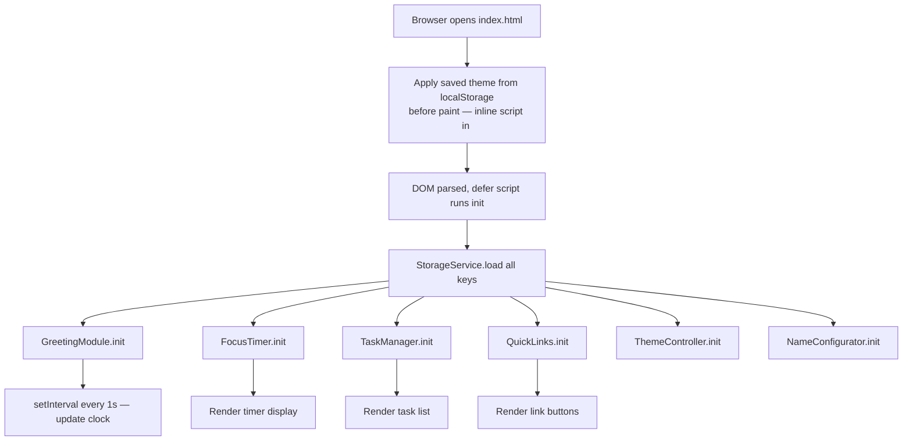
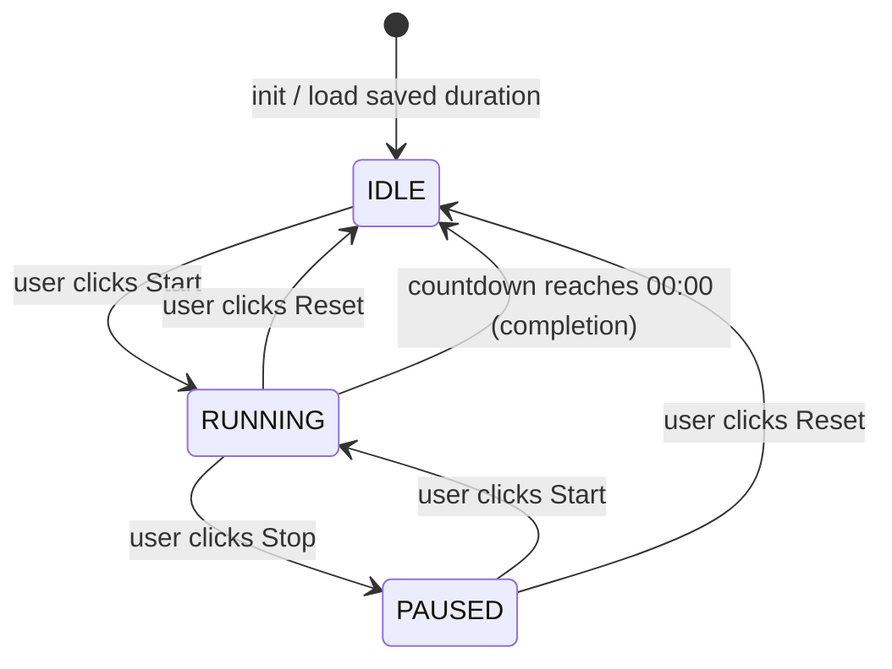

# Design Document

## Overview

The To-Do List Life Dashboard is a purely client-side, single-page web application (SPA) built with plain HTML, CSS, and Vanilla JavaScript. It runs without a backend server or build step — the user opens a single HTML file in any modern browser and the full application initialises immediately.

The application is composed of six loosely coupled modules that share a central Storage abstraction layer backed by the browser's `localStorage` API:

1. **Greeting Module** — live clock, date, time-based greeting, and custom name display.
2. **Focus Timer** — Pomodoro-style countdown with configurable duration.
3. **Task Manager** — CRUD operations on a persistent ordered to-do list.
4. **Quick Links** — user-defined shortcut buttons to external URLs.
5. **Theme Controller** — light / dark mode toggle with FOUC prevention.
6. **Name Configurator** — custom name input, validation, and persistence.

All user data (tasks, name, timer duration, theme, quick links) is stored exclusively in `localStorage`. No external JavaScript libraries or frameworks are used.

---

## Architecture

### Application Structure

```
project-root/
├── index.html          # Single HTML entry point
├── css/
│   └── styles.css      # All styles, including CSS custom properties for theming
└── js/
    └── app.js          # All JavaScript — module functions, event handlers, init
```

The entire application logic lives in `js/app.js`. It is structured as a collection of self-contained module objects (plain object literals with methods), wired together by an `init()` function that runs on `DOMContentLoaded`. There is no bundler, transpiler, or module system — the script is loaded with a `defer` attribute on the `<script>` tag.

### Execution Flow



### FOUC Prevention Strategy

To prevent a flash of unstyled content when applying the saved theme, a small inline `<script>` block is placed inside `<head>` (before any stylesheet link). It reads `localStorage.getItem('theme')` synchronously and sets a `data-theme` attribute on `<html>` before the first paint. The CSS file uses `[data-theme="dark"]` selectors to apply the dark palette. This guarantees the correct theme is applied on the very first render.

### Module Communication

Modules do not directly call each other. They communicate only through:
- **DOM events** — standard browser events (click, input, submit) handled by each module.
- **StorageService** — the shared persistence abstraction; modules read/write through it rather than calling `localStorage` directly.

This keeps modules independent and testable in isolation.

---

## Components and Interfaces

### StorageService

Central abstraction over `localStorage`. All modules use this service rather than calling `localStorage` directly, so that Storage unavailability is handled in one place.

```js
StorageService = {
  // Storage keys (constants)
  KEYS: {
    TASKS:     'tld_tasks',
    NAME:      'tld_name',
    DURATION:  'tld_duration',
    THEME:     'tld_theme',
    LINKS:     'tld_links',
  },

  // Returns parsed value or null. Never throws.
  get(key),

  // Serialises value and writes it. Returns true on success, false on failure.
  set(key, value),

  // Removes a key. Returns true on success, false on failure.
  remove(key),

  // Returns true if localStorage is available and writable.
  isAvailable(),
}
```

### GreetingModule

Displays the live clock, current date, and personalised time-based greeting.

```js
GreetingModule = {
  // Starts the 1-second interval, renders initial state.
  init(),

  // Called every second by setInterval. Updates clock and greeting DOM.
  tick(),

  // Returns the greeting string for a given hour (0–23).
  // Pure function — no DOM side effects.
  getGreetingForHour(hour),   // → "Good Morning" | "Good Afternoon" | "Good Evening" | "Good Night"

  // Returns the formatted time string "HH:MM:SS" for a given Date object.
  // Pure function.
  formatTime(date),           // → "HH:MM:SS"

  // Returns the formatted date string "DayName, DD MonthName YYYY".
  // Pure function.
  formatDate(date),           // → e.g. "Monday, 22 October 2026"

  // Returns the full greeting string combining greeting + optional name.
  // Pure function. Truncates name to 30 chars if longer.
  buildGreetingText(hour, name), // → e.g. "Good Morning, Alex"
}
```

### FocusTimer

Manages the Pomodoro countdown state machine.

```js
FocusTimer = {
  // Timer states
  STATE: { IDLE: 'idle', RUNNING: 'running', PAUSED: 'paused' },

  // Reads saved duration, renders display, wires controls.
  init(),

  // Starts or resumes the countdown.
  start(),

  // Pauses the countdown, retains remaining time.
  stop(),

  // Resets countdown to configured duration, transitions to IDLE.
  reset(),

  // Internal: called every second by setInterval when running.
  _tick(),

  // Called when countdown reaches 00:00. Shows completion notification.
  _onComplete(),

  // Returns "MM:SS" for a given total seconds value.
  // Pure function.
  formatDisplay(totalSeconds),  // → "MM:SS"

  // Validates a duration value. Returns true if 1 ≤ value ≤ 120.
  // Pure function.
  isValidDuration(value),       // → boolean
}
```

**State Machine:**



### TaskManager

Manages the ordered list of to-do tasks.

```js
TaskManager = {
  // Loads tasks from Storage, renders list.
  init(),

  // Validates title (1–200 chars), creates Task object, appends to list, saves.
  addTask(title),

  // Validates new title (1–200 chars), updates Task, saves.
  editTask(id, newTitle),

  // Toggles Task completion status, saves.
  toggleTask(id),

  // Removes Task by id, saves.
  deleteTask(id),

  // Renders all tasks to the DOM in insertion order.
  _render(),

  // Validates a task title. Returns true if 1 ≤ title.trim().length ≤ 200.
  // Pure function.
  isValidTitle(title),   // → boolean
}
```

### QuickLinks

Manages user-defined URL shortcut buttons.

```js
QuickLinks = {
  // Loads links from Storage, renders buttons.
  init(),

  // Validates label (1–50 chars, non-whitespace) and URL (valid, http/https, ≤2048 chars), adds link, saves.
  addLink(label, url),

  // Removes link by id, saves.
  deleteLink(id),

  // Renders all link buttons to the DOM.
  _render(),

  // Validates a URL: non-empty, starts with http:// or https://, length ≤ 2048.
  // Pure function.
  isValidUrl(url),    // → boolean

  // Validates a label: non-empty after trim, length 1–50.
  // Pure function.
  isValidLabel(label), // → boolean
}
```

### ThemeController

Toggles and persists the light/dark theme.

```js
ThemeController = {
  // Reads saved theme, wires toggle control.
  init(),

  // Switches to the opposite theme, saves to Storage, applies within 100ms.
  toggle(),

  // Applies a theme ('light' | 'dark') to the document by setting data-theme on <html>.
  _apply(theme),
}
```

### NameConfigurator

Handles the custom name input, validation, and persistence.

```js
NameConfigurator = {
  // Loads saved name, populates input field.
  init(),

  // Validates name (1–50 chars), saves to Storage, triggers GreetingModule refresh.
  saveName(value),

  // Clears saved name from Storage, triggers GreetingModule refresh.
  clearName(),

  // Validates a name. Returns true if 1 ≤ value.length ≤ 50.
  // Pure function.
  isValidName(value),  // → boolean
}
```

---

## Data Models

All data is serialised as JSON strings in `localStorage`. Below are the in-memory structures that are serialised/deserialised.

### Task

```js
/**
 * @typedef {Object} Task
 * @property {string}  id         - Unique identifier (timestamp-based, e.g. Date.now().toString())
 * @property {string}  title      - Task description, 1–200 characters
 * @property {boolean} completed  - Completion status
 * @property {number}  createdAt  - Unix timestamp (ms) for insertion-order sorting
 */
```

**Storage key:** `tld_tasks`
**Stored as:** JSON array of Task objects, e.g.:
```json
[
  { "id": "1729598400000", "title": "Buy groceries", "completed": false, "createdAt": 1729598400000 },
  { "id": "1729598460000", "title": "Read a book",   "completed": true,  "createdAt": 1729598460000 }
]
```

### QuickLink

```js
/**
 * @typedef {Object} QuickLink
 * @property {string} id     - Unique identifier (timestamp-based)
 * @property {string} label  - Display label, 1–50 characters
 * @property {string} url    - Full URL, starting with http:// or https://, max 2048 chars
 */
```

**Storage key:** `tld_links`
**Stored as:** JSON array of QuickLink objects.

### StoredName

**Storage key:** `tld_name`
**Stored as:** Plain JSON string, 1–50 characters. Absent if no name has been set.

### StoredDuration

**Storage key:** `tld_duration`
**Stored as:** JSON number (integer), 1–120. Absent if no custom duration has been saved; default is 25.

### StoredTheme

**Storage key:** `tld_theme`
**Stored as:** JSON string, `"light"` or `"dark"`. Absent if no preference has been saved; default is `"light"`.

### Default Values Summary

| Module             | Storage Key      | Default (when absent or unparseable) |
|--------------------|-----------------|--------------------------------------|
| Task list          | `tld_tasks`     | `[]` (empty array)                   |
| Custom name        | `tld_name`      | `null` (no name displayed)           |
| Pomodoro duration  | `tld_duration`  | `25` (minutes)                       |
| Theme              | `tld_theme`     | `"light"`                            |
| Quick links        | `tld_links`     | `[]` (empty array)                   |

---

## Correctness Properties

*A property is a characteristic or behavior that should hold true across all valid executions of a system — essentially, a formal statement about what the system should do. Properties serve as the bridge between human-readable specifications and machine-verifiable correctness guarantees.*

### Property 1: Time formatting always produces zero-padded HH:MM:SS

*For any* Date object with hours in [0, 23], minutes in [0, 59], and seconds in [0, 59], `GreetingModule.formatTime(date)` SHALL return a string that exactly matches the regular expression `/^\d{2}:\d{2}:\d{2}$/` and whose three colon-delimited segments equal the zero-padded hour, minute, and second of the given Date.

**Validates: Requirements 1.1**

---

### Property 2: Date formatting always produces the correct "DayName, DD MonthName YYYY" string

*For any* valid Date object, `GreetingModule.formatDate(date)` SHALL return a string whose day-name component is one of the seven English weekday names, whose day-of-month component is zero-padded to two digits and matches the Date's `getDate()` value, whose month name is one of the twelve English month names and matches `getMonth()`, and whose year is the four-digit value from `getFullYear()`.

**Validates: Requirements 1.2**

---

### Property 3: Every hour (0–23) maps to exactly one correct greeting

*For any* integer hour in [0, 23], `GreetingModule.getGreetingForHour(hour)` SHALL return `"Good Morning"` when hour is in [5, 11], `"Good Afternoon"` when hour is in [12, 17], `"Good Evening"` when hour is in [18, 21], and `"Good Night"` when hour is in [22, 23] or [0, 4]. The return value SHALL always be one of these four strings and no other.

**Validates: Requirements 1.3, 1.4, 1.5, 1.6**

---

### Property 4: Greeting text correctly incorporates name with truncation

*For any* integer hour in [0, 23] and any non-empty string `name`:
- If `name.length <= 30`, `GreetingModule.buildGreetingText(hour, name)` SHALL return a string equal to `getGreetingForHour(hour) + ", " + name`.
- If `name.length > 30`, `GreetingModule.buildGreetingText(hour, name)` SHALL return a string equal to `getGreetingForHour(hour) + ", " + name.slice(0, 30)`.
- If `name` is `null`, `undefined`, or empty, `buildGreetingText` SHALL return a string equal to `getGreetingForHour(hour)` with no name suffix.

**Validates: Requirements 1.7, 1.8, 1.9**

---

### Property 5: Name validation accepts exactly the range [1, 50] and rejects outside it

*For any* string `value`:
- `NameConfigurator.isValidName(value)` SHALL return `true` if and only if `value.length >= 1` and `value.length <= 50`.
- It SHALL return `false` for the empty string and for any string longer than 50 characters.

**Validates: Requirements 2.5, 2.6**

---

### Property 6: Name persistence round-trip

*For any* valid name string (1–50 characters), calling `NameConfigurator.saveName(value)` followed by `StorageService.get(StorageService.KEYS.NAME)` SHALL return a value strictly equal to the original `value`.

**Validates: Requirements 2.2, 6.2**

---

### Property 7: Timer display formatting always produces zero-padded MM:SS

*For any* integer `totalSeconds` in [0, 7200] (the maximum valid timer range: 120 min × 60 s), `FocusTimer.formatDisplay(totalSeconds)` SHALL return a string that exactly matches `/^\d{2}:\d{2}$/`, where the minutes segment equals `Math.floor(totalSeconds / 60)` zero-padded to two digits, and the seconds segment equals `totalSeconds % 60` zero-padded to two digits.

**Validates: Requirements 3.1**

---

### Property 8: Duration validation accepts exactly the range [1, 120] and rejects outside it

*For any* numeric value `v`:
- `FocusTimer.isValidDuration(v)` SHALL return `true` if and only if `v` is an integer and `1 <= v <= 120`.
- It SHALL return `false` for values less than 1, greater than 120, non-integer numbers, and non-numeric inputs.

**Validates: Requirements 4.2, 4.3**

---

### Property 9: Duration persistence round-trip

*For any* valid duration integer `d` in [1, 120], after persisting `d` via `StorageService.set(StorageService.KEYS.DURATION, d)`, calling `StorageService.get(StorageService.KEYS.DURATION)` SHALL return a value strictly equal to `d`.

**Validates: Requirements 4.4, 6.3**

---

### Property 10: Task title validation accepts exactly the range [1, 200] and rejects outside it

*For any* string `title`:
- `TaskManager.isValidTitle(title)` SHALL return `true` if and only if `title.trim().length >= 1` and `title.trim().length <= 200`.
- It SHALL return `false` for empty strings, whitespace-only strings, and strings exceeding 200 characters after trimming.

**Validates: Requirements 5.2, 5.3, 5.6**

---

### Property 11: Adding a valid task grows the list by exactly one and the task is findable

*For any* task list state and *any* valid task title (1–200 chars), calling `TaskManager.addTask(title)` SHALL result in the task list length increasing by exactly 1, and the list SHALL contain exactly one task whose `title` property equals the submitted title.

**Validates: Requirements 5.2**

---

### Property 12: Editing a task preserves all other tasks unchanged

*For any* task list with at least one task, and *any* valid new title (1–200 chars), calling `TaskManager.editTask(id, newTitle)` SHALL update only the targeted task's title property while leaving all other tasks (and the total list length) unchanged.

**Validates: Requirements 5.5**

---

### Property 13: Toggling task completion twice restores the original state

*For any* task, calling `TaskManager.toggleTask(id)` twice SHALL result in the task's `completed` property being identical to its value before the first toggle was applied.

**Validates: Requirements 5.7**

---

### Property 14: Deleting a task removes exactly that task from the list

*For any* task list containing a task with a given `id`, calling `TaskManager.deleteTask(id)` SHALL result in a list that does not contain any task with that `id`, and whose length is exactly one less than the original list length.

**Validates: Requirements 5.8**

---

### Property 15: Task list renders in ascending insertion order

*For any* array of Task objects with distinct `createdAt` values, after loading and rendering, the displayed order SHALL correspond to ascending `createdAt` values (oldest first), regardless of the order the objects appeared in storage.

**Validates: Requirements 5.9**

---

### Property 16: Storage serialization round-trip preserves task list structure

*For any* array of Task objects (each with `id`, `title`, `completed`, `createdAt`), calling `StorageService.set(KEYS.TASKS, tasks)` followed by `StorageService.get(KEYS.TASKS)` SHALL return an array deeply equal to the original, with no loss or mutation of any field.

**Validates: Requirements 5.11, 6.1**

---

### Property 17: Corrupted or unparseable storage values return null

*For any* key and *any* string value that cannot be parsed by `JSON.parse` (or that does not conform to the expected type for that key), `StorageService.get(key)` SHALL return `null` without throwing an exception.

**Validates: Requirements 6.7**

---

### Property 18: Quick Links URL validation rejects non-http(s) URLs

*For any* string `url`:
- `QuickLinks.isValidUrl(url)` SHALL return `true` if and only if `url` starts with `"http://"` or `"https://"` (case-sensitive) and `url.length <= 2048` and `url.trim().length > 0`.
- It SHALL return `false` for any URL starting with any other scheme (e.g., `"ftp://"`, `"mailto:"`, `"javascript:"`), any empty or whitespace string, and any URL exceeding 2048 characters.

**Validates: Requirements 7.4**

---

### Property 19: Adding a Quick Link grows the list by exactly one and the link is findable

*For any* links list state and *any* valid (label, url) pair, calling `QuickLinks.addLink(label, url)` SHALL result in the links list length increasing by exactly 1, and the list SHALL contain exactly one entry with the given `label` and `url`.

**Validates: Requirements 7.2**

---

### Property 20: Deleting a Quick Link removes exactly that entry from the list

*For any* links list containing an entry with a given `id`, calling `QuickLinks.deleteLink(id)` SHALL result in a list that does not contain any entry with that `id`, and whose length is exactly one less than the original length.

**Validates: Requirements 7.6**

---

### Property 21: Theme toggle is an involution (toggling twice returns original theme)

*For any* starting theme `t` (either `"light"` or `"dark"`), calling `ThemeController.toggle()` twice SHALL result in the active theme being equal to `t`, and `StorageService.get(KEYS.THEME)` SHALL return `t`.

**Validates: Requirements 8.2, 6.4**

---

## Error Handling

### StorageService Errors

`StorageService.set()` wraps every `localStorage.setItem()` call in a `try/catch`. On failure (e.g., storage quota exceeded, private browsing mode in some browsers):
- Returns `false`.
- The calling module retains its current in-memory state unchanged.
- The calling module renders an inline error banner ("Data could not be saved. Changes may be lost after reload.").

`StorageService.get()` wraps `localStorage.getItem()` + `JSON.parse()` in a `try/catch`. On any failure:
- Returns `null`.
- The calling module initialises with its documented default value.

`StorageService.isAvailable()` performs a write/read/delete test in a `try/catch`. Returns `false` if any step throws.

### Validation Errors (Inline)

Each module that accepts user input renders a validation error message adjacent to the failing input field. Error messages:

| Scenario | Message |
|---|---|
| Task title empty | "Task title cannot be empty." |
| Task title > 200 chars | "Task title must be 200 characters or fewer." |
| Custom name empty (on submit) | "Name must be between 1 and 50 characters." |
| Custom name > 50 chars | "Name must be between 1 and 50 characters." |
| Pomodoro duration out of range | "Duration must be a whole number between 1 and 120 minutes." |
| Quick Link label empty/whitespace | "Link label cannot be empty." |
| Quick Link URL empty/whitespace | "URL cannot be empty." |
| Quick Link URL invalid scheme | "URL must start with http:// or https://." |

Error messages are cleared when the user modifies the associated input field (on `input` event).

### Storage Unavailability

If `StorageService.isAvailable()` returns `false` during module initialisation:
- The module renders with its default state.
- An inline error notice is shown within that module's section.
- The rest of the Dashboard continues to function normally.

### API Unavailability (Browser Compatibility)

If `typeof localStorage === 'undefined'` or `localStorage` is not accessible:
- A global banner at the top of the page notifies the user that persistence is unavailable.
- All modules operate in-memory only for the session.

---

## Testing Strategy

### Dual Testing Approach

The testing strategy uses two complementary layers:

1. **Property-based tests** — verify universal correctness of pure functions across randomised inputs.
2. **Example-based unit tests** — verify specific behaviours, state machine transitions, UI rendering, and integration with the DOM.

### Property-Based Testing Library

Since this project uses Vanilla JavaScript with no build step, the property-based tests are written as standalone scripts using **[fast-check](https://github.com/dubzzz/fast-check)** (loaded from a CDN in the test HTML harness, or via `npm install fast-check --save-dev` for a local test runner). Each property-based test is configured to run a minimum of **100 iterations**.

Each test is tagged with a comment linking it to the design property:

```js
// Feature: todo-life-dashboard, Property 3: Every hour (0-23) maps to exactly one correct greeting
fc.assert(
  fc.property(fc.integer({ min: 0, max: 23 }), (hour) => {
    const result = GreetingModule.getGreetingForHour(hour);
    const valid = ["Good Morning", "Good Afternoon", "Good Evening", "Good Night"];
    return valid.includes(result);
  }),
  { numRuns: 100 }
);
```

### Property Tests (one test per Correctness Property)

| Property | Function Under Test | Generator |
|---|---|---|
| P1 — Time formatting | `formatTime` | Random Date objects |
| P2 — Date formatting | `formatDate` | Random Date objects |
| P3 — Greeting for hour | `getGreetingForHour` | `fc.integer({ min: 0, max: 23 })` |
| P4 — Greeting text with name | `buildGreetingText` | `fc.integer(0,23)` × `fc.string()` |
| P5 — Name validation | `isValidName` | `fc.string()` |
| P6 — Name persistence round-trip | `saveName` + `get` | `fc.string({ minLength: 1, maxLength: 50 })` |
| P7 — Timer display formatting | `formatDisplay` | `fc.integer({ min: 0, max: 7200 })` |
| P8 — Duration validation | `isValidDuration` | `fc.integer()` |
| P9 — Duration persistence round-trip | `StorageService.set/get` | `fc.integer({ min: 1, max: 120 })` |
| P10 — Task title validation | `isValidTitle` | `fc.string()` |
| P11 — Add task grows list | `addTask` | `fc.string({ minLength: 1, maxLength: 200 })` |
| P12 — Edit task preserves others | `editTask` | `fc.array(taskArb)` × `fc.string(1,200)` |
| P13 — Toggle twice = original | `toggleTask` | `fc.record({ completed: fc.boolean() })` |
| P14 — Delete task removes exactly one | `deleteTask` | `fc.array(taskArb, { minLength: 1 })` |
| P15 — Insertion-order rendering | `_render` | `fc.array(taskArb, { minLength: 2 })` shuffled |
| P16 — Task list storage round-trip | `StorageService.set/get` | `fc.array(taskArb)` |
| P17 — Corrupted storage returns null | `StorageService.get` | `fc.string()` (non-JSON) |
| P18 — URL validation | `isValidUrl` | `fc.string()`, `fc.webUrl()` |
| P19 — Add link grows list | `addLink` | valid `(label, url)` pairs |
| P20 — Delete link removes exactly one | `deleteLink` | `fc.array(linkArb, { minLength: 1 })` |
| P21 — Theme toggle is involution | `toggle` + `get` | `fc.constantFrom("light", "dark")` |

### Example-Based Unit Tests

Focus on behaviours that are not universal properties:

- **FocusTimer state machine**: start → running, stop → paused, reset → idle, completion → idle + notification visible.
- **FocusTimer control disabling**: Start button disabled in RUNNING state; Stop button disabled in IDLE and PAUSED states.
- **Greeting display on load**: GreetingModule.init() reflects saved name from storage in the DOM.
- **Task edit UI**: Activating edit control renders an input pre-filled with current title.
- **Quick Link opens new tab**: Rendered anchor has `target="_blank"` and `rel="noopener noreferrer"`.
- **Theme on load**: FOUC-prevention inline script sets `data-theme` before stylesheet is applied.
- **Default values on cleared storage**: Each module initialises to its documented default when storage keys are absent.

### Integration Tests

- Dashboard initialisation with all storage keys populated: each module reflects stored values after `init()`.
- Storage unavailability: modules render default state and show error notices when `localStorage` is disabled.
- Storage write failure: module retains in-memory state and shows error banner.

### Manual / Visual Tests

- WCAG AA contrast verification (light and dark modes) using a colour contrast tool.
- Cross-browser smoke test (Chrome, Firefox, Edge, Safari) for layout, interactivity, and storage persistence.
- Responsive layout verification at 320px, 768px, 1280px, and 2560px viewport widths.
